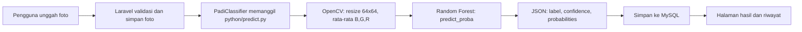

<div align="center">

# 🌾 OryzaCare AI

**Deteksi penyakit daun padi dari satu foto — cepat, jelas, dan disertai rekomendasi tindakan.**


</div>

---

## 📖 Tentang Proyek

**OryzaCare AI** adalah aplikasi web berbasis **Laravel 13** yang mengenali penyakit pada daun padi memakai model **Random Forest** (scikit-learn). Pengguna cukup mengunggah foto daun, lalu sistem menampilkan:

- 🖼️ foto yang dianalisis
- 🦠 jenis penyakit yang terdeteksi
- 📊 tingkat keyakinan (persen) dan peluang tiap kelas
- 🩺 kondisi tanaman
- ✅ tindakan rekomendasi dan ciri-ciri penyakit
- 🕘 riwayat analisis yang dapat dibuka kembali kapan saja

Tampilan bertema hijau, responsif untuk HP, tablet, dan desktop.

---

## ✨ Fitur

| Fitur | Keterangan |
|---|---|
| **Deteksi foto** | Unggah lewat pilih berkas, seret-lepas, atau kamera HP. Format JPG, PNG, WEBP, maksimal 8 MB. |
| **Hasil lengkap** | Penyakit, tingkat keyakinan, kondisi, rekomendasi tindakan, ciri-ciri, dan peluang tiap kelas. |
| **Peringatan keyakinan rendah** | Muncul otomatis jika keyakinan di bawah 60%. |
| **Riwayat analisis** | Grid foto, filter per penyakit, paginasi, buka kembali hasil, dan hapus. |
| **Responsif** | Menu hamburger di HP dan tata letak satu kolom di layar kecil. |

### Penyakit yang dikenali

| Kelas model | Nama di aplikasi | Penyebab |
|---|---|---|
| `Bacterialblight` | Hawar Daun Bakteri (Kresek) | Bakteri *Xanthomonas oryzae* |
| `Blast` | Blas | Jamur *Pyricularia oryzae* |
| `Brownspot` | Bercak Coklat | Jamur *Bipolaris oryzae* |
| `Tungro` | Tungro | Virus (ditularkan wereng hijau) |

---

## 🧠 Cara Kerja



### Tentang model

| Item | Nilai |
|---|---|
| Algoritma | Random Forest (`n_estimators=100`, `max_depth=10`, `random_state=42`) |
| Fitur | 3 nilai: rata-rata kanal **B, G, R** dari gambar yang di-resize ke **64×64** |
| Data | 5.932 gambar (4.745 latih, 1.187 uji, split 80/20 dengan `stratify`) |
| Akurasi uji | **98,48%** (precision 0,9851, recall 0,9848, F1 0,9847) |
| Baseline SVM | 63,02% |

> **Penting:** preprocessing di `python/predict.py` harus **identik** dengan saat training di Google Colab (baca BGR, resize 64×64, rata-rata per kanal). Jangan diubah tanpa melatih ulang model.

---

## 📁 Struktur Folder

Hanya file yang ditambahkan atau diubah untuk proyek ini yang diberi keterangan. Folder bawaan Laravel lainnya (`bootstrap/`, `storage/`, `vendor/`, dan sebagainya) tidak diubah.

```text
oryzacare-ai/
├── app/
│   ├── Http/
│   │   ├── Controllers/
│   │   │   ├── DetectionController.php   # Alur: beranda, deteksi, hasil, riwayat, hapus
│   │   │   └── StatsController.php       # JSON statistik pengunjung untuk footer
│   │   └── Middleware/
│   │       └── TrackVisitor.php          # Mencatat pengunjung (cookie anonim + tanggal)
│   ├── Models/
│   │   └── Analysis.php                  # Model tabel analyses (+ helper info penyakit, level, waktu)
│   └── Services/
│       ├── PadiClassifier.php            # Memanggil Python dan membaca hasil JSON
│       └── SiteStats.php                 # Menghitung statistik pengunjung dan deteksi
│
├── config/
│   └── padi.php                          # Pengaturan Python/model + data penyakit & rekomendasi
│
├── database/
│   └── migrations/
│       ├── 2026_11_05_000000_create_analyses_table.php
│       └── 2026_11_05_000100_create_visits_table.php   # Tabel pengunjung
│
├── public/
│   ├── css/
│   │   ├── padi.css                      # Gaya umum (halaman, kartu, hasil, riwayat)
│   │   ├── header.css                    # Gaya header dan animasi menu
│   │   ├── footer.css                    # Gaya footer dan statistik
│   │   ├── detect.css                    # Gaya halaman Deteksi (kartu ketentuan, tips, kartu penyakit)
│   │   ├── history.css                   # Gaya halaman Riwayat (pencarian, filter, kartu, indikator halaman)
│   │   ├── hero.css                      # Gaya hero Beranda (panel kaca, tombol hijau, kartu mengelilingi model)
│   │   ├── diseases.css                  # Gaya Jenis penyakit di Beranda (kartu bergaris bergerak)
│   │   ├── cara.css                      # Gaya Cara pakai di Beranda (tab, animasi tiap langkah, garis waktu)
│   │   └── recent.css                    # Gaya Analisis terbaru dan Catatan penting di Beranda
│   ├── js/
│   │   ├── padi.js                       # Cara kerja, animasi scroll, form deteksi
│   │   ├── header.js                     # Menu mobile, penanda tab animatif, efek klik
│   │   ├── footer.js                     # Angka statistik berjalan dan pembaruan otomatis
│   │   ├── detect.js                     # Pratinjau, validasi format/ukuran, pop up, loading, dan Coba Foto Lain
│   │   ├── fit.js                        # Dipanggil halaman Deteksi (detect.blade.php)
│   │   ├── history.js                    # Pencarian, 4 kartu per halaman + indikator
│   │   ├── herocards.js                  # Kartu hero: angka berhitung naik, buka detail, kilau kursor
│   │   ├── diseases.js                   # Tinggi layar dan efek muncul Jenis penyakit di Beranda
│   │   ├── cara.js                       # Perpindahan langkah otomatis berputar (1 → 2 → 3 → 1) dan tinggi layar
│   │   └── recent.js                     # Tinggi layar dan penanda foto rusak di Beranda
│   ├── images/
│   │   ├── logo.png                      # Logo dan ikon tab browser
│   │   ├── bgfooter.jpg                  # Latar footer (736 x 414)
│   │   ├── farmer.png                    # Ilustrasi petani di footer
│   │   ├── notfound.png                  # Maskot mencari (Cara pakai langkah 2, riwayat kosong)
│   │   ├── padi.png                      # Maskot padi (Cara pakai langkah 1 dan 2)
│   │   ├── padisakit.png                 # Maskot sakit (Cara pakai langkah 2)
│   │   ├── padisehat.png                 # Maskot sehat (Cara pakai langkah 3)
│   │   └── penyakit/                     # (opsional) foto contoh: Blast.jpg, Tungro.jpg, dst.
│   └── uploads/analisis/                 # Foto hasil unggahan pengguna (dibuat otomatis)
│
├── python/
│   ├── predict.py                        # Skrip prediksi (dipanggil Laravel)
│   ├── model_random_forest.pkl           # Model hasil training Google Colab
│   ├── requirements.txt                  # Dependensi Python
│   └── venv/                             # Virtual environment Python (dibuat saat instalasi)
│
├── resources/
│   └── views/
│       ├── layouts/app.blade.php         # Kerangka halaman (memanggil header dan footer)
│       ├── partials/
│       │   ├── header.blade.php          # Header putih + menu
│       │   ├── footer.blade.php          # Footer: deskripsi, tautan cepat, petani, statistik pengunjung
│       │   ├── history-card.blade.php    # Kartu riwayat (dipakai Riwayat dan Beranda)
│       │   ├── hero.blade.php            # Hero Beranda: judul, deskripsi, tombol, model 3D/ASCII, 3 kartu
│       │   ├── diseases.blade.php        # Jenis penyakit (Beranda)
│       │   ├── howto.blade.php           # Cara pakai: tiga langkah (Beranda)
│       │   └── recent.blade.php          # Analisis terbaru + Catatan penting (Beranda)
│       ├── pagination/padi.blade.php     # Tampilan paginasi kustom
│       ├── home.blade.php                # Beranda
│       ├── detect.blade.php              # Halaman unggah foto
│       ├── result.blade.php              # Halaman hasil analisis
│       └── history.blade.php             # Riwayat analisis
│
├── routes/
│   └── web.php                           # Daftar rute
│
├── training/
│   └── UTSAI.ipynb                       # Hasil Training
│
└── .env                                  # Konfigurasi lingkungan (database, PADI_PYTHON)
```

---

## 🛠️ Prasyarat

| Kebutuhan | Versi |
|---|---|
| PHP | 8.3 atau lebih baru |
| Composer | 2.x |
| MySQL | Dari Laragon |
| Python | 3.12 atau lebih baru |
| Laragon | Full (disarankan, Windows) |

Node.js **tidak diperlukan** karena tampilan memakai CSS dan JS biasa.

---

## 🚀 Instalasi (Windows + Laragon)

Semua perintah dijalankan di **Terminal Laragon**. Contoh ini memakai lokasi `D:\oryzacare-ai`.

### 1. Buat project Laravel
```bash
cd /d D:\
composer create-project laravel/laravel oryzacare-ai "^13.0"
```

### 2. Buat database
Pastikan MySQL di Laragon sudah menyala (**Start All**), lalu:
```bash
mysql -u root -e "CREATE DATABASE oryzacare_ai CHARACTER SET utf8mb4 COLLATE utf8mb4_unicode_ci"
```

### 3. Atur `.env`
Buka `D:\oryzacare-ai\.env`, lalu ganti atau tambahkan:
```env
APP_NAME="OryzaCare AI"
APP_LOCALE=id
APP_URL=http://localhost:8000

DB_CONNECTION=mysql
DB_HOST=127.0.0.1
DB_PORT=3306
DB_DATABASE=oryzacare_ai
DB_USERNAME=root
DB_PASSWORD=

PADI_PYTHON="D:/oryzacare-ai/python/venv/Scripts/python.exe"
```
> Gunakan garis miring biasa (`/`) pada `PADI_PYTHON`.

### 4. Siapkan Python
```bash
cd /d D:\oryzacare-ai\python
python -m venv venv
venv\Scripts\pip install -r requirements.txt
```
Versi **scikit-learn harus 1.6.1** karena sama dengan versi yang dipakai saat model disimpan.

### 5. Migrasi database
```bash
cd /d D:\oryzacare-ai
php artisan migrate
php artisan config:clear
```

---

## ▶️ Menjalankan

```bash
cd /d D:\oryzacare-ai
php artisan serve
```
Buka **http://localhost:8000**.

Untuk mengakses dari HP di Wi-Fi yang sama:
```bash
php artisan serve --host=0.0.0.0 --port=8000
```
lalu buka `http://IP-LAPTOP:8000` (izinkan PHP di Windows Firewall jika diminta).

---

## 🧭 Cara Memakai

1. Buka menu **Deteksi** dan pilih atau seret foto daun padi.
2. Klik **Analisis Sekarang** dan tunggu beberapa detik.
3. Baca hasil: penyakit, keyakinan, kondisi, dan tindakan rekomendasi.
4. Buka menu **Riwayat** untuk melihat atau menghapus analisis sebelumnya.

**Tips foto terbaik:** satu helai daun dari dekat, cahaya alami cukup, latar polos, dan bercak terlihat jelas.

---

## 🔗 Daftar Rute

| Metode | URL | Fungsi |
|---|---|---|
| GET | `/` | Beranda |
| GET | `/deteksi` | Form unggah foto |
| POST | `/deteksi` | Proses analisis |
| GET | `/hasil/{id}` | Hasil analisis |
| GET | `/riwayat` | Riwayat (filter: `?penyakit=Blast`) |
| DELETE | `/riwayat/{id}` | Hapus riwayat dan foto |

---

## 🧪 Menguji Python Secara Terpisah

```bash
cd /d D:\oryzacare-ai\python
venv\Scripts\python predict.py "C:\path\ke\foto.jpg"
```
Contoh keluaran:
```json
{"label": "Blast", "confidence": 97.0, "probabilities": {"Bacterialblight": 1.0, "Blast": 97.0, "Brownspot": 1.0, "Tungro": 1.0}, "features_bgr": [52.1, 118.4, 96.3]}
```

---

## 🩹 Pemecahan Masalah

| Masalah | Penyebab dan solusi |
|---|---|
| `Python tidak dapat dijalankan` | Path `PADI_PYTHON` di `.env` salah. Pastikan `python.exe` ada di `venv\Scripts`, lalu jalankan `php artisan config:clear`. |
| `WinError 10106 ... service provider could not be loaded` | `php artisan serve` di Windows membuang variabel `SystemRoot`. Sudah ditangani oleh `PadiClassifier::environment()`. Pastikan file tersebut terbaru, lalu restart `php artisan serve`. |
| `Library Python belum lengkap` | Dependensi belum terpasang di venv. Jalankan ulang `venv\Scripts\pip install -r requirements.txt`. |
| Peringatan versi scikit-learn | Pasang versi yang sama dengan Colab: `pip install scikit-learn==1.6.1`. |
| Unggahan gagal untuk foto besar | Naikkan `upload_max_filesize` dan `post_max_size` di `php.ini` (Laragon → Menu → PHP → php.ini), lalu restart. |
| `SQLSTATE ... Connection refused` | MySQL belum menyala atau data `.env` salah. Klik **Start All** di Laragon. |
| Halaman tidak berubah setelah edit `.env` | Jalankan `php artisan config:clear`. |

---

## ⚠️ Keterbatasan

- Model hanya mengenali **4 penyakit**. Daun sehat atau objek lain tetap akan dikelompokkan ke salah satu penyakit.
- Model memakai fitur **warna rata-rata** saja, jadi hasil dapat dipengaruhi pencahayaan, latar, dan kamera. Gunakan foto yang jelas.
- Akurasi 98,48% adalah hasil pada data uji dataset ini. Performa pada foto lapangan perlu diuji lagi.
- Rekomendasi bersifat panduan umum. Jenis dan dosis pestisida wajib mengikuti label produk dan anjuran penyuluh pertanian (PPL) setempat.

---

## 🔮 Ide Pengembangan

- Menambah kelas **daun sehat** dan **bukan daun** agar sistem lebih andal.
- Fitur yang lebih kaya (tekstur, bentuk bercak, atau CNN) untuk generalisasi yang lebih baik.
- Login pengguna agar riwayat bersifat pribadi.
- Ekspor hasil analisis ke PDF.
- Foto contoh tiap penyakit di beranda (letakkan di `public/images/penyakit/`).

---

## 🤝 Kontribusi dan Lisensi

Proyek ini dibuat untuk UTS APLIKASI KECERDASAN BUATAN.

<div align="center">

</div>